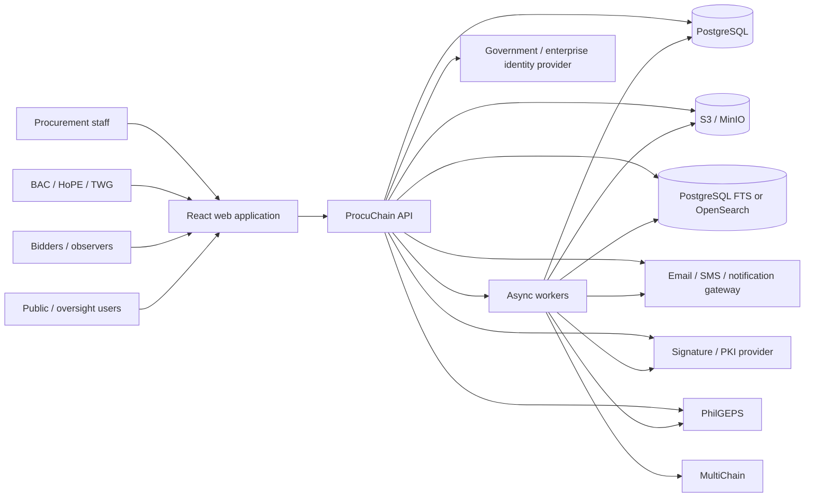

# Architecture Specification: Rust eProcurement Document Platform

> **Status:** Build target
> **Specification version:** 0.1
> **Depends on:** [Domain Model](domain-model.md), [Platform Specification](platform-spec.md), [Compliance Specification](compliance-spec.md)

## 1. Purpose and architectural stance

The target is a **Rust modular monolith** with asynchronous workers, designed to become a service platform when scaling or organizational separation requires it. The modular monolith reduces premature distributed-system complexity while preserving explicit boundaries for document storage, workflows, compliance, signatures, publication, search, and evidence.

### ARC-001 — Technology baseline

The target stack is:

| Concern | Target |
| --- | --- |
| Language | Rust 2024 edition, stable toolchain, MSRV pinned in `rust-toolchain.toml`. |
| HTTP/API | Axum with Tokio; versioned JSON/OpenAPI API. |
| Database | PostgreSQL using SQLx with checked queries or offline metadata. |
| Object storage | S3-compatible object storage; MinIO for local development. |
| Search | PostgreSQL full-text search initially; OpenSearch is an optional later projection. |
| Background work | Durable PostgreSQL-backed queue initially, with an outbox and worker pool. |
| Frontend | React 19 + TypeScript + Vite, reusing the existing design system where useful. |
| Rendering | Versioned document-rendering service; deterministic PDF/DOCX output is preferred. |
| Signatures | Provider adapters for approved PKI/e-signature services. |
| Integrity anchor | MultiChain adapter, optional and asynchronous. |
| Observability | Structured logs, metrics, traces, and immutable audit-event export. |

The architecture MUST NOT require MultiChain availability for core document creation, review, approval, signature, issuance, or retrieval.

### ARC-002 — Explicit API boundary

The frontend and integrations MUST use an explicit REST/OpenAPI contract rather than Laravel/Inertia page contracts. The target API exposes resource behavior, validation, pagination, errors, and authorization consistently.

## 2. System context



### ARC-003 — Trust boundaries

Trust boundaries exist at:

1. public/external client to API;
2. authenticated staff client to API;
3. API to PostgreSQL;
4. API/worker to object storage;
5. API/worker to external signature provider;
6. API/worker to PhilGEPS;
7. API/worker to MultiChain;
8. API to identity and notification providers.

Every external call MUST use narrowly scoped credentials, timeouts, retry policy, structured error mapping, and audit correlation.

## 3. Modular architecture

### ARC-010 — Modules

The codebase MUST be organized into these bounded modules:

```text
api
├── identity-access
├── organization
├── documents
├── templates
├── workflow
├── compliance
├── tasks-deadlines
├── approvals
├── signatures
├── issuance-distribution
├── publication
├── records-management
├── collaboration
├── procurement
│   ├── planning
│   ├── readiness
│   ├── bidding
│   ├── evaluation
│   ├── award
│   ├── contract
│   ├── protests
│   └── sanctions
├── evidence-audit
├── search
├── notifications
└── integrations
    ├── identity
    ├── signature
    ├── philgeps
    ├── multichain
    └── notification
```

### ARC-011 — Module rules

A module MUST own its domain types, invariants, persistence mapping, and public application API. Cross-module calls MUST use typed application interfaces or domain events rather than direct access to another module's tables.

### ARC-012 — Shared kernel

A shared kernel MAY contain identifiers, time, money, hashing, authorization primitives, error taxonomy, and pagination. It MUST NOT contain procurement rules or workflow business logic.

### ARC-013 — Dependency direction

Dependencies SHOULD point inward:

```text
domain → application ports → infrastructure adapters
```

HTTP handlers, SQLx repositories, queue workers, and external clients belong to infrastructure/application layers and MUST NOT contain domain decisions.

### ARC-014 — Legal isolation

The compliance module MUST own legal-source interpretation, requirement review state, rule packs, and control evaluation. Other modules consume evaluated controls and MUST NOT implement statutory formulas ad hoc.

## 4. API design

### ARC-020 — REST conventions

Resources MUST use stable opaque IDs and plural nouns. The API SHOULD support:

```text
GET    /api/v1/documents
POST   /api/v1/documents
GET    /api/v1/documents/{document_id}
GET    /api/v1/documents/{document_id}/versions
POST   /api/v1/documents/{document_id}/versions
POST   /api/v1/document-versions/{version_id}/submit
POST   /api/v1/document-versions/{version_id}/approvals
POST   /api/v1/document-versions/{version_id}/signature-requests
POST   /api/v1/document-versions/{version_id}/issuances
GET    /api/v1/tasks
POST   /api/v1/tasks/{task_id}/claim
POST   /api/v1/tasks/{task_id}/complete
GET    /api/v1/compliance/control-outcomes
GET    /api/v1/procurement-cases
POST   /api/v1/procurement-cases/{case_id}/transitions
```

The actual OpenAPI document is the contract. Endpoint names in this specification are illustrative.

### ARC-021 — Commands versus resources

State-changing legal actions SHOULD use explicit command endpoints or transitions with an idempotency key and expected version. A generic `PATCH document` MUST NOT change a controlled state.

### ARC-022 — Idempotency

Every state-changing request that can be retried MUST accept an idempotency key. The server MUST bind the key to actor, operation, request hash, and result.

### ARC-023 — Optimistic concurrency

Mutable aggregate commands MUST accept an expected version or `ETag`. Conflicting writes MUST return a conflict response and MUST NOT overwrite newer state.

### ARC-024 — Error model

Errors MUST contain a stable machine code, human message, correlation ID, field violations, and safe details. Internal stack traces, secrets, and sensitive legal content MUST NOT be returned.

### ARC-025 — Authorization

Authorization MUST be evaluated server-side. UI visibility is not an authorization control.

### ARC-026 — File transfer

Uploads and downloads MUST use short-lived, purpose-bound URLs or streamed endpoints with malware-scanning state enforcement. Direct public object-store URLs MUST NOT bypass authorization.

### ARC-027 — Bulk export

Bulk exports MUST be asynchronous, scoped, audited, and delivered through expiring access. The export manifest MUST identify omissions and confidentiality redactions.

## 5. Persistence architecture

### ARC-030 — PostgreSQL role

PostgreSQL is the system of record for:

- identity and organization mappings;
- documents, versions, metadata, and relationships;
- workflow definitions, instances, tasks, decisions, and timers;
- legal sources, requirements, rules, rule packs, and control outcomes;
- procurement entities and lifecycle events;
- signatures, issuance, distribution, acknowledgements, and publications;
- audit events, evidence manifests, and anchor references;
- retention schedules, holds, and dispositions;
- outbox, job, and idempotency records.

### ARC-031 — Object storage role

Object storage holds:

- canonical-content snapshots if not stored as PostgreSQL JSONB;
- rendered artifacts;
- uploaded source files;
- OCR derivatives and extracted text;
- controlled legal-source snapshots;
- evidence-bundle archives;
- export files.

Objects MUST use immutable, unique keys. Mutable logical references point to a new object rather than overwriting bytes.

### ARC-032 — Database conventions

- PostgreSQL UUIDs identify records.
- `timestamptz` stores instants.
- JSONB MAY store versioned canonical documents and rule definitions, but critical queryable relations and legal facts MUST use typed columns or normalized tables.
- Every mutable aggregate MUST have a concurrency version.
- Soft deletion MUST be explicit and MUST NOT be used for evidence-bearing records where disposition requires a tombstone.
- Database constraints MUST enforce uniqueness, references, and critical state invariants.

### ARC-033 — Transaction boundary

A command that changes aggregate state MUST update the aggregate, its audit event, and the outbox event in one PostgreSQL transaction.

### ARC-034 — Audit storage

Audit events SHOULD use append-only table permissions and hash chaining. The application role MUST NOT update or delete them. High-assurance deployments MAY additionally stream signed/daily Merkle roots to MultiChain.

### ARC-035 — Search index

The initial search projection MUST be PostgreSQL full-text search over metadata, extracted text, and canonical content. It MUST apply the same tenant and authorization filters as the source query.

If OpenSearch is introduced, it MUST be a rebuildable projection and MUST never become the authority for a legal state or deadline.

## 6. Document storage and rendering

### ARC-040 — Canonical content persistence

Canonical content MUST be stored in a versioned schema with a canonical serialization and SHA-256 hash. The canonical bytes MUST be reproducible from the stored representation.

### ARC-041 — Rendering pipeline


The renderer MUST be version-pinned. A changed renderer creates a new artifact; it MUST NOT replace the historical artifact.

### ARC-042 — Determinism

For a given canonical version, template version, renderer version, fonts, locale, and rendering parameters, the platform SHOULD produce byte-identical output. Non-determinism MUST be disclosed through artifact metadata and MUST NOT affect the canonical hash.

### ARC-043 — Source preservation

Original external uploads MUST be preserved byte-for-byte alongside any internal structured rendition. The source artifact MUST remain the evidentiary object even when the canonical version is a structured transcription.

### ARC-044 — Malware scanning

Uploads MUST be quarantined until scanning completes. Failed or unscanned objects MUST NOT be exposed for download or processing.

### ARC-045 — OCR and extraction

OCR and text extraction MUST run asynchronously, record engine/version/confidence, and write derived artifacts separately from source and canonical content.

### ARC-046 — Thumbnail generation

Thumbnails and previews MUST be derived artifacts, clearly labeled, and MUST NOT replace official rendered artifacts.

## 7. Workflow engine

### ARC-050 — Engine scope

The workflow engine is a generic, deterministic state-machine engine driven by versioned definitions. It MUST support the step types in PLAT-032 and the rule outcomes in CMP-030.

### ARC-051 — Execution model

A workflow transition MUST execute in this order:

1. authorize actor and command;
2. load current aggregate and expected version;
3. validate snapshot versions and active configuration;
4. resolve trigger and conditions;
5. evaluate hard and conditional controls;
6. evaluate quorum/voting rules;
7. perform domain mutation;
8. write audit and outbox events in the same transaction;
9. create tasks, timers, notifications, and integration jobs after commit.

### ARC-052 — Side-effect isolation

External publication, signing, notification, OCR, and anchoring MUST occur outside the state transaction. The local state advances to a pending state, and completion is reconciled through idempotent callbacks or workers.

### ARC-053 — Configuration validation

Workflow definitions MUST be schema-validated, dependency-validated, legally reviewed, and simulation-tested before activation.

### ARC-054 — Long-running instances

Workflow state MUST NOT be held in memory. A command MUST load current state from PostgreSQL. Workers MAY lease tasks but MUST use compare-and-swap or equivalent to prevent duplicate completion.

## 8. Compliance engine

### ARC-060 — Rule representation

Rules SHOULD use a constrained, versioned expression language with typed values and an allow-listed function registry. Arbitrary Rust or SQL evaluation from rule text is prohibited.

### ARC-061 — Rule evaluation

A rule evaluator MUST be pure and deterministic given inputs, rule version, calendar version, and parameter set. It MUST produce an explanation tree suitable for display.

### ARC-062 — Formula registry

Regulated formulas SHOULD be implemented as typed Rust functions registered behind stable formula IDs, with unit tests and golden cases. A formula ID MUST link to a compliance requirement and rule-pack version.

### ARC-063 — Legal-source pipeline


No machine-extracted text may become an active hard rule without human review.

### ARC-064 — Rule-pack assembly

A rule pack MUST be assembled from immutable versions and signed by a manifest hash. Activation MUST record legal, product, and operations approvals.

### ARC-065 — Snapshot lookup

At the reviewed commencement event, the platform MUST resolve and persist a rule-pack snapshot. The snapshot MUST be queryable by procurement and workflow instance.

## 9. Deadline engine

### ARC-070 — Time representation

The engine MUST distinguish instants, local dates, calendar days, working days, and inclusive/exclusive periods. A period rule MUST declare its unit and boundary semantics.

### ARC-071 — Calendar

A versioned `HolidayCalendar` contains timezone, regular non-working days, holidays, local declarations, exceptional proclamations, and effective intervals. Calendars MUST be immutable after use.

### ARC-072 — Trigger semantics

Each trigger type MUST define when it is considered received and how time is measured. Examples include issuance of a resolution, confirmed receipt, or portal receipt.

### ARC-073 — Tolling

Tolling MUST use an append-only interval set. The engine MUST merge overlapping intervals without double-counting and MUST retain the authority for each.

### ARC-074 — Replay

A deadline MUST be reproducible from stored trigger, rule, calendar, and tolling events. Recomputation SHOULD produce the same due value unless an explicit reviewed correction exists.

### ARC-075 — Time authority

The platform MUST use a reputable time source and UTC internally. It MUST NOT use the browser clock as authority for a deadline.

## 10. Signatures

### ARC-080 — Adapter contract

A signature provider adapter MUST support:

- provider capability discovery;
- identity/certificate lookup;
- signature-request creation;
- status polling or callback;
- signed artifact retrieval;
- verification;
- revocation/expiry status;
- idempotent reconciliation.

### ARC-081 — Provider independence

Core workflows MUST depend on the adapter contract, not a provider SDK. Provider-specific fields MUST be preserved in an evidence extension, not leak into the core model.

### ARC-082 — Callback security

Callbacks MUST be authenticated, replay-resistant, schema-validated, and idempotent. A callback MUST NOT be trusted merely because it references a known transaction ID.

### ARC-083 — Signing ceremony

The server MUST create the signing request against an immutable version and artifact. The client MUST not be able to swap the artifact after the request is created.

### ARC-084 — Evidence and verification

The platform MUST store provider evidence, signed artifact, hashes, and verification result. It MUST offer a verification report even after the external provider's status endpoint becomes unavailable.

## 11. PhilGEPS integration

### ARC-090 — Adapter boundary

All PhilGEPS operations MUST be implemented behind an adapter with capability discovery because current APIs, credentials, and migration procedures are deployment-specific and **legal/operations review required**.

### ARC-091 — Publication intent

A publication request MUST contain the exact artifact hash, channel, account, scheduled window, content metadata, and idempotency key. Submission receipts MUST reconcile to that intent.

### ARC-092 — Reconciliation

A scheduled job MUST compare intended, submitted, remotely visible, and locally evidenced publications. Mismatches MUST create alerts and tasks.

### ARC-093 — Manual fallback

If no API is available, the platform MUST provide a manual workflow that captures operator, timestamp, reference, proof, validation, and second-person confirmation where the PE policy requires it. A screenshot alone does not prove exact content unless the control says so.

### ARC-094 — Bid intake

Bid intake through PhilGEPS MUST preserve the official receipt and submitted artifact. The local case view MUST distinguish portal-submitted content from locally created records.

### ARC-095 — Rate and outage handling

Retries MUST use bounded exponential backoff and idempotency. Outages MUST NOT be converted into successful publication states. The system MUST display degraded-channel status and escalate missed legal windows.

## 12. MultiChain anchoring

### ARC-100 — Scope

MultiChain MAY anchor:

- document-version hashes;
- evidence-bundle manifests;
- workflow-event batches or daily Merkle roots;
- publication receipts;
- external-chain transaction identifiers.

### ARC-101 — Non-authoritative boundary

The chain MUST NOT be queried to decide current workflow state, legal deadlines, authorization, or document availability. The local database remains authoritative.

### ARC-102 — Asynchronous operation

Anchoring MUST NOT block document or workflow transactions. A durable outbox job MUST retry with bounded backoff and expose failed anchors for operational recovery.

### ARC-103 — Idempotency

An anchor job MUST use a deterministic idempotency key. Retries MUST NOT create semantically duplicate anchors for the same subject and batch.

### ARC-104 — Verification

Users MUST be able to compare a local hash or manifest with an anchor. The verification UI MUST state what the anchor proves and what it does not prove.

### ARC-105 — Existing streams

During migration, the platform SHOULD recognize the legacy streams as historical evidence and MAY continue writing compatible anchors where useful:

- `procurement.metadata`
- `procurement.documents`
- `procurement.status`
- `procurement.events`
- `procurement.corrections`
- `procurement.metadata.corrections`
- `procurement.archive`
- `file.data`
- `file.metadata`
- `file.chunks`

The target domain MUST NOT depend on these stream names.

## 13. Identity and access

### ARC-110 — Authentication

The API MUST support OIDC/OAuth 2.1 through a configurable identity provider. Local accounts MAY exist for controlled development and emergency break-glass operation.

### ARC-111 — Government identity

Use of a government identity or PKI provider MUST be configurable per deployment. The platform MUST support identity assurance levels, MFA, recovery, and account lifecycle.

### ARC-112 — Authorization model

Authorization MUST combine RBAC with attributes:

- tenant;
- organization;
- committee or matter membership;
- document classification;
- workflow step;
- legal role;
- external relationship;
- effective time;
- delegation and authority.

### ARC-113 — Service accounts

Service accounts MUST be non-interactive, narrowly scoped, short-lived where possible, and represented as `ServiceIdentity` actors in the audit trail.

### ARC-114 — Break-glass

Emergency access MUST require strong authentication, a reason, time-limited approval where practicable, prominent logging, and post-event review.

## 14. Notifications

### ARC-120 — Durable event consumer

Notification requests MUST be written to an outbox in the same transaction as the triggering event. Workers dispatch them and record delivery attempts.

### ARC-121 — Templates

Notification content MUST be versioned and linked to the legal rule or operational policy that requires it. Critical legal notices SHOULD use controlled document generation and issuance rather than an unconstrained email body.

### ARC-122 — Delivery adapters

Email, SMS, and other channels MUST implement a common interface with delivery receipts. The initial release MAY support email plus manual/offline notice evidence.

### ARC-123 — Suppression and bounce

Bounces, complaints, and invalid addresses MUST create an operational task; they MUST not be interpreted as legal receipt.

## 15. Background jobs

### ARC-130 — Durable queue

The initial queue MUST use PostgreSQL with `FOR UPDATE SKIP LOCKED` or an equivalent safe leasing pattern. A library MAY be introduced, but the durable-job semantics MUST remain explicit.

### ARC-131 — Job categories

- OCR and extraction;
- artifact rendering;
- indexing;
- malware scanning;
- notifications;
- signature reconciliation;
- publication submission and reconciliation;
- evidence bundling;
- anchoring;
- retention/disposition review;
- integration reconciliation.

### ARC-132 — Retry policy

Jobs MUST have bounded retries, exponential backoff, a dead-letter state, idempotency, and operator replay that creates a new attempt event.

### ARC-133 — Poison messages

A job that repeatedly fails MUST be quarantined with its payload hash, error, attempt history, and escalation. It MUST NOT spin indefinitely.

## 16. Observability

### ARC-140 — Correlation

Every HTTP request, domain command, audit event, job, notification, and external call SHOULD carry a correlation ID and, where available, causation ID.

### ARC-141 — Metrics

Metrics MUST cover request latency/error rate, database pool, queue depth/age, job failure, publication reconciliation, signature latency/failure, OCR backlog, search latency, and audit-ingest lag.

### ARC-142 — Logging

Operational logs MUST be structured and MUST redact secrets, tokens, bid contents where inappropriate, and personal data. Logs MUST NOT replace the audit event store.

### ARC-143 — Tracing

Distributed traces SHOULD cover API, database, worker, and external-provider spans while avoiding sensitive document bodies.

### ARC-144 — Health

Liveness MUST indicate process health. Readiness MUST reflect required dependencies. Degraded modes MUST be explicit where core transaction safety is preserved.

## 17. Security architecture

### ARC-150 — Encryption

- TLS MUST be required externally and between sensitive services.
- PostgreSQL, object storage, backups, and queues MUST use encryption at rest.
- Application-level envelope encryption SHOULD protect especially sensitive fields and objects.
- Keys MUST be held by a KMS/HSM or equivalent managed service, not source code or environment files.

### ARC-151 — Object access

Object keys and identifiers are not authorization. Every download MUST be authorized against the logical document and artifact.

### ARC-152 — Malware isolation

Untrusted files MUST remain in quarantine until scanned. Scanned derivatives MUST retain lineage.

### ARC-153 — Content security

Rendered documents and previews MUST prevent active content execution. Sanitization MUST be versioned for rich text and annotations.

### ARC-154 — Data protection

Personal and confidential data MUST have field/document classification, least-privilege access, purpose, retention, and disclosure logs. Applicable privacy obligations require deployment-specific legal review.

### ARC-155 — Supply-chain security

Rust dependencies MUST be locked and reviewed. The build SHOULD produce an SBOM, pin toolchain components, and verify source provenance where practical.

## 18. Availability, backup, and disaster recovery

### ARC-160 — Service objectives

Production objectives MUST be approved per deployment. The baseline design target is:

| Objective | Baseline target | Requirement |
| --- | --- | --- |
| Availability | 99.9% monthly, excluding announced maintenance | Deployment target; approval required. |
| Recovery point objective | ≤ 15 minutes for metadata; ≤ 24 hours for object store under the baseline design | Deployment target; approval required. |
| Recovery time objective | ≤ 4 hours | Deployment target; approval required. |
| Restore test | At least annually and after material architecture change | Implementation requirement. |

### ARC-161 — Backup

PostgreSQL MUST use point-in-time recovery backups. Object storage MUST use versioning/replication and a documented restore test. Search indexes MUST be rebuildable.

### ARC-162 — Multi-tenancy

For a multi-tenant deployment, tenant isolation MUST be tested at database, object-store, search, cache, background-job, logging, and export boundaries. Row-level security MAY supplement application authorization but MUST NOT replace it.

### ARC-163 — Regional resilience

The baseline MAY operate in one region with replicated backups. Multi-region active/passive SHOULD be reserved for deployments whose continuity requirements justify it.

## 19. Deployment topology

### ARC-170 — Minimum production topology

- Load balancer / reverse proxy;
- at least two stateless API replicas;
- PostgreSQL with managed or highly available deployment;
- S3-compatible object storage;
- worker pool;
- internal job/notification integration gateway;
- isolated administrative access;
- centralized logs, metrics, and traces.

### ARC-171 — Environments

Development, test, staging, and production MUST be separated. Production credentials and procurement data MUST NOT be copied into lower environments. Synthetic data SHOULD be used for development and testing.

### ARC-172 — Infrastructure as code

Deployment and infrastructure configuration SHOULD be reproducible through version-controlled code. Manual emergency changes MUST be logged and reconciled.

### ARC-173 — Maintenance

Maintenance MUST consider statutory deadlines and active procurement cases. A planned outage MUST not silently extend a legal deadline; the clock follows the applicable rule and authorized suspension.

## 20. Migration from the Laravel implementation

### ARC-180 — Migration as extraction

The legacy system is a source of historical records and business knowledge, not the behavioral authority. Migration MUST preserve source identifiers, timestamps, actors, hashes, chain references, and original artifacts.

### ARC-181 — Migration inventory

Before cutover, inventory:

- users, roles, units, BAC rosters, and delegated authority;
- procurements and lifecycle states;
- documents, metadata, corrections, and access logs;
- file chunks and hashes;
- blockchain streams and transaction references;
- search documents and reports;
- external identifiers and PhilGEPS references.

### ARC-182 — Import model

The importer MUST create legacy source artifacts, immutable legacy document versions, provenance records, and a manifest. It MUST NOT fabricate approvals, signatures, acknowledgements, or rule compliance that the source lacks.

### ARC-183 — Legacy lifecycle mapping

Legacy statuses MUST be mapped to target states with explicit reason and confidence. Unmappable records MUST enter a review queue rather than being assigned a guessed compliant state.

### ARC-184 — MultiChain history

Legacy chain records MUST be imported as corroborating evidence with network, stream, transaction, key/address, timestamp, and payload hash. The importer MUST verify payload reconstruction and identify missing or inconsistent records.

### ARC-185 — Parallel run

A limited parallel run SHOULD compare new-case creation, deadlines, document counts, and evidence bundles between old and target paths without allowing dual authoritative writes to the same case.

### ARC-186 — Cutover

Cutover MUST use a documented rehearsal, reconciliation, freeze or controlled dual-run, rollback plan, and business sign-off. Historical records remain accessible after the legacy application is retired.

### ARC-187 — No destructive replacement

The target MUST NOT overwrite or delete legacy source data during import. Destructive retirement or archival requires an approved records/disposition process.

## 21. Frontend architecture

### ARC-190 — Feature-oriented React

The frontend SHOULD be organized by product capability:

```text
src/
├── app/
├── auth/
├── workspace/
├── documents/
├── templates/
├── workflows/
├── compliance/
├── procurement/
├── contracts/
├── records/
├── search/
├── notifications/
├── integrations/
└── shared/
```

### ARC-191 — Server state

The frontend SHOULD use generated OpenAPI clients and a query cache for server state. Workflow commands MUST use explicit mutations with optimistic concurrency and idempotency.

### ARC-192 — Authorization UX

The client MAY hide unavailable actions, but the API remains authoritative. The UI MUST explain a blocked action using the control result without exposing confidential legal analysis.

### ARC-193 — Accessibility and auditability

The frontend MUST meet WCAG 2.2 AA target for procurement-critical tasks and MUST provide keyboard access, visible focus, status announcements, and printable evidence views. Accessibility conformance requires a separate audit.

### ARC-194 — Document renderer safety

The browser MUST NOT render untrusted document HTML without sanitization. Official artifacts SHOULD be served through controlled preview or download.

## 22. Testing architecture

### ARC-200 — Test layers

| Layer | Purpose |
| --- | --- |
| Unit | Domain invariants, formula functions, condition evaluation, state transitions. |
| Property | Hash/canonicalization, money/calculation, deadline boundaries, state-machine invariants. |
| Contract | Module interfaces and external-provider adapters. |
| Integration | PostgreSQL, object store, queue, search, identity, signing, and publication fakes/contracts. |
| Feature/API | User journeys, authorization, idempotency, concurrency, and audit reconstruction. |
| Legal-control | Each hard rule with positive, negative, boundary, and historical-snapshot cases. |
| End-to-end | Browser workflows for the first vertical slice and critical procurement paths. |
| Migration | Repeatable import, hash reconciliation, mapping, and rollback rehearsal. |
| Security | Tenant isolation, object authorization, privilege escalation, upload safety, and secret leakage. |
| Performance | Deadline scans, search, rendering, evidence bundling, and publication queues. |

### ARC-201 — Deterministic time

Tests MUST inject clock and calendar providers. Tests MUST cover deadlines exactly at the start, before start, on the last day, after the last day, on a non-working day, and around tolling.

### ARC-202 — Legal fixture set

Every activated hard rule MUST have fixtures derived from the reviewed legal text and approved examples. Test fixtures MUST cite the rule and explain expected outcomes.

### ARC-203 — External fake servers

PhilGEPS, signature, identity, and notification integrations MUST have contract-faithful fakes for normal, asynchronous, duplicate, expired, rejected, and outage scenarios.

### ARC-204 — Audit assertions

Tests MUST assert that material actions create immutable audit events and that the evidence bundle reconstructs the relevant decision.

## 23. Delivery plan

### ARC-210 — Increment 1: platform foundation

- identity, tenant, organization, role, and committee model;
- document, version, artifact, metadata, and audit foundation;
- PostgreSQL/object storage;
- structured template and one approval/signature/issuance workflow;
- OpenAPI and React workbench;
- basic evidence export.

### ARC-211 — Increment 2: legal foundation

- legal register;
- requirement and rule model;
- rule-pack snapshots;
- deadline engine;
- compliance outcomes and review queue;
- PhilGEPS adapter boundary and manual fallback.

### ARC-212 — Increment 3: first procurement slice

- PPMP, Indicative APP, BAC recommendation/resolution, HoPE approval, final APP, signature, issuance, and acknowledgement;
- GPPB standard-form source handling;
- vertical-slice acceptance and audit evidence.

### ARC-213 — Increment 4: bidding through award

- initiation and mode selection;
- readiness, Bidding Documents, publication, pre-bid, bulletin;
- eligibility, submission, opening, evaluation, post-qualification;
- award recommendation and HoPE decision.

### ARC-214 — Increment 5: contract and remedies

- contract formation and implementation;
- obligations, variations, security, warranty, closure;
- protests/reconsiderations;
- sanctions.

### ARC-215 — Increment 6: records and scale

- retention, legal hold, disposition;
- full search/OCR depth;
- evidence bundles and integration reconciliation;
- performance, disaster recovery, migration rehearsal, and production hardening.

## 24. Architecture acceptance summary

The architecture satisfies this specification when it can demonstrate:

1. core procurement work succeeds independently of MultiChain;
2. a workflow command commits state, audit, and outbox atomically;
3. a failed PhilGEPS call never becomes a successful publication;
4. a signature cannot be attached to a changed artifact;
5. a deadline is replayable from stored inputs;
6. a historical rule pack remains immutable after legal updates;
7. tenant and object authorization are enforced server-side;
8. a backup restore preserves database/object consistency;
9. legacy records retain provenance and are not assigned fabricated compliance;
10. the first vertical slice passes feature, legal-control, security, and audit tests.
