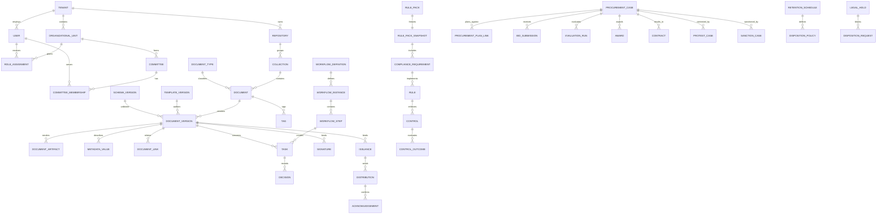
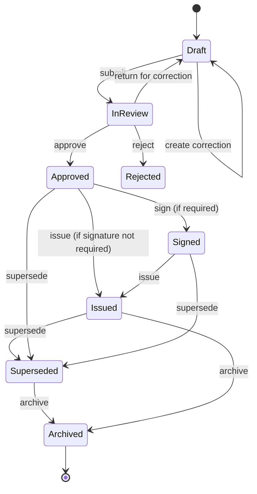

# Domain Model: ProcuChain eProcurement Document Platform

> **Status:** Build target
> **Specification version:** 0.1
> **Depends on:** [Product Specification](product-spec.md), [Platform Specification](platform-spec.md), [Compliance Specification](compliance-spec.md)

## 1. Purpose

This document defines the target platform's conceptual domain model, entity relationships, state machines, invariants, identifiers, and temporal behavior. It is a logical contract, not a physical database schema.

## 2. Modeling conventions

### DOM-001 — Aggregate boundaries

The platform SHOULD use the following aggregate boundaries:

- **Records:** document and version lifecycle;
- **Workflow:** definitions, instances, tasks, decisions, and timers;
- **Compliance:** legal register, requirements, rules, controls, and rule packs;
- **Procurement:** cases, plans, modes, bids, awards, contracts, protests, and sanctions;
- **Collaboration:** comments, annotations, and mentions;
- **Evidence:** audit events, bundles, and anchors;
- **Records management:** retention schedules, holds, and dispositions.

Cross-aggregate references SHOULD use immutable identifiers. Cross-aggregate writes SHOULD use events or application services rather than direct table mutation.

### DOM-002 — Identity

All persistent entities MUST have an opaque, globally unique, non-semantic identifier. Human-readable numbers or codes MUST be separate attributes and MUST NOT be the primary key.

### DOM-003 — Time

Timestamps MUST be stored as UTC instants with nanosecond or microsecond precision as supported. The original local date/time, timezone, and calendar must be retained when a legal or operational deadline depends on them.

### DOM-004 — Versioning

Configuration, legal content, templates, workflows, and documents that participate in evidence MUST be versioned and immutable after activation.

## 3. High-level relationship view



## 4. Identity and organization

### DOM-010 — Tenant / Procuring Entity

`Tenant` represents the security and legal boundary of a Procuring Entity. It contains identity, timezone, authoritative calendar, locale, organizational units, repositories, retention policies, legal sources, and configuration.

A deployment MAY host one tenant or multiple tenants. Tenant isolation MUST be enforced at every authorization and query boundary.

### DOM-011 — User and service identity

`User` represents a human actor. `ServiceIdentity` represents an automated actor. Both MUST have an immutable identity, status, authentication references, and auditable credential metadata.

Credentials and private keys MUST NOT be stored in the core user record.

### DOM-012 — Organizational unit

`OrganizationalUnit` represents an office, End-User, implementing unit, PMO, Secretariat, or other subdivision. It supports hierarchy, head, valid-time interval, and cost-center or appropriation linkage.

### DOM-013 — Role and assignment

`Role` defines a set of abstract permissions. `RoleAssignment` binds a user or service to a role in an organizational unit, committee, matter, or time interval.

Role assignments MUST support start and end dates, delegation source, scope, and revocation.

### DOM-014 — Committee and membership

`Committee` represents the BAC, TWG, or another body. `CommitteeMembership` records seat type, designation instrument, rank or qualification, term, alternate status, and status.

Membership must preserve the roster snapshot used by a workflow instance.

### DOM-015 — Authority instrument

`AuthorityInstrument` records a delegation, designation, appointment, resolution, or policy that grants authority. It MUST include issuer, scope, authority basis, effective interval, source artifact, and revocation or supersession evidence.

## 5. Document and records entities

### DOM-020 — Repository

`Repository` is the top-level records boundary. It defines owning organization, default classification, retention policy, default access policy, and preservation capabilities.

### DOM-021 — Collection

`Collection` groups documents for business or records purposes. It MAY be hierarchical, case-based, project-based, or flat. A document MAY be in multiple collections without duplication.

### DOM-022 — Document

`Document` is the stable logical business record. It contains:

- tenant and repository;
- document type;
- title and business identifier;
- owning organization;
- subject matter and external references;
- current version pointer;
- workflow instance pointer;
- lifecycle status;
- security classification;
- retention policy;
- legal-hold aggregate state;
- created and closed timestamps.

A document does not own workflow history directly; that belongs to the workflow instance.

### DOM-023 — Document version

`DocumentVersion` is an immutable snapshot of canonical content and provenance. It contains:

- document and monotonically increasing version number;
- status: `draft`, `in_review`, `approved`, `signed`, `issued`, `superseded`, `withdrawn`, or `archived`;
- canonical content and hash;
- template, schema, and renderer versions;
- author, author time, and source version;
- correction and supersession references;
- rule-pack and workflow-definition snapshot references;
- signature and issuance state.

Draft snapshots MAY be edited by creating another draft version; the previous version remains in history once submitted.

### DOM-024 — Canonical content and blocks

Canonical content SHOULD use a versioned JSON-compatible schema. `ContentBlock` supports paragraph, heading, list, table, key-value grid, controlled clause, field, calculation, signature placeholder, attachment reference, and page-break directives.

The schema MUST prohibit executable or unknown script content.

### DOM-025 — Artifact

`DocumentArtifact` is a rendered or external file associated with one version. It contains hash, media type, size, storage locator, renderer version, creation time, fixity state, and provenance.

The same logical artifact MAY be referenced by multiple distribution records. It MUST NOT be physically duplicated merely for each recipient.

### DOM-026 — Metadata

`MetadataDefinition` defines fields and controlled vocabularies. `MetadataValue` binds a value to a document version. Metadata definitions and value changes MUST be version-aware.

Metadata MUST support business, legal, records, security, and provenance dimensions without forcing one flat table to serve all of them.

### DOM-027 — Document link

`DocumentLink` is a typed, version-aware edge between documents or versions. It supports direction, cardinality, basis, creator, time, and explanation.

### DOM-028 — Tag

`Tag` is a controlled or user-defined label. It MUST NOT substitute for a governed metadata field.

### DOM-029 — External submission

`ExternalSubmission` represents an externally authored document or package. It contains submitter assertion, organization, channel, received time, envelope, artifact, hash, validation and scan results, correspondence, and decision.

An accepted external submission MAY be referenced by an internal document but MUST NOT be represented as internally authored.

## 6. Template and authoring entities

### DOM-030 — Document type

`DocumentType` defines purpose, owner, default schema, default workflow, signature matrix, publication rules, and retention class.

### DOM-031 — Template

`Template` is the logical family. `TemplateVersion` is immutable and contains schema, layout, default content, validation rules, rendering instructions, optional clauses, and authority basis.

### DOM-032 — Template variable and clause

`TemplateVariable` defines a data binding, type, allowed source, validation, and conditional visibility. `ClauseLibraryEntry` contains controlled text, jurisdiction, authority, version, and usage restrictions.

### DOM-033 — Draft session

`DraftSession` tracks an editable work state, base version, editor, autosave checkpoints, and conflict token. A draft session MUST produce a new immutable `DocumentVersion` before it can enter workflow.

## 7. Workflow entities

### DOM-040 — Workflow definition

`WorkflowDefinition` is the logical identity. `WorkflowDefinitionVersion` contains steps, conditions, roles, quorum, deadlines, evidence, escalation, and effective metadata.

### DOM-041 — Workflow instance

`WorkflowInstance` binds a document version to a workflow-definition version and rule-pack snapshot. It contains actor snapshot, start event, current state, completion event, and correlation data.

### DOM-042 — Step

`WorkflowStep` is a node in an instance. It contains type, position, condition, assignee rule, timer, outcome paths, required evidence, and escalation.

### DOM-043 — Task

`Task` is an actionable unit assigned to an actor or actor set. It contains due date, status, block state, wake condition, source event, and completion action.

### DOM-044 — Decision

`Decision` records approval, rejection, return, abstention, recusal, or another workflow outcome. It binds actor, role, document version, reason, evidence, rule version, and time.

### DOM-045 — Approval set and quorum result

`ApprovalSet` groups decisions under a quorum/voting rule. `QuorumResult` records eligible membership snapshot, attendance, quorum threshold, votes, abstentions, conflicts, outcome, and computation trace.

### DOM-046 — Workflow timer

`WorkflowTimer` references a deadline rule, trigger, due value, calendar, tolling state, and linked obligation.

### DOM-047 — Transition

`WorkflowTransition` records attempted and completed movement between states, with control evaluations and resulting tasks.

## 8. Approval and signature entities

### DOM-050 — Signature request

`SignatureRequest` binds a document version, artifact, signer, authority, method, purpose, provider, evidence package, deadline, and status.

### DOM-051 — Signature

`Signature` binds one signer to one signed artifact or provider object. It contains provider reference, credential/certificate reference, signed hash, signed time, validation, revocation, and evidence.

### DOM-052 — Signature method and matrix

`SignatureMethod` represents an approved method and provider. `SignatureRequirement` maps document type, signer class, and purpose to required method, order, and wet-signature rule.

### DOM-053 — Issuance

`Issuance` binds an approved/signed document version to an issuer, authority, issuance basis, issue time, official status, recipients/channels, and manifest.

### DOM-054 — Distribution

`Distribution` records one recipient or channel's intended delivery of an issued version/artifact. It contains attempt, result, receipt reference, due date, and acknowledgement requirement.

### DOM-055 — Acknowledgement

`Acknowledgement` binds recipient assertion to a distributed artifact and time, with method and optional declaration.

## 9. Compliance entities

### DOM-060 — Legal authority

`LegalAuthority` represents an issuing body and authority class.

### DOM-061 — Legal instrument and version

`LegalInstrument` is the logical source. `LegalInstrumentVersion` is an immutable official snapshot with dates, source URL, local object hash, publication data, and status.

### DOM-062 — Legal provision

`LegalProvision` identifies a section/paragraph within an instrument version and stores the exact excerpt and locator.

### DOM-063 — Compliance requirement

`ComplianceRequirement` is the reviewed implementation statement. It links to provisions, records applicability, control type, owner, review status, effective dates, and test references.

### DOM-064 — Rule and control

`Rule` contains executable expression, type, parameters, version, and test fixtures. `Control` binds rules to a workflow transition, document event, or record-lifecycle point.

### DOM-065 — Control evaluation and outcome

`ControlEvaluation` records the evaluated control and version. `ControlOutcome` records result, reason, input snapshot, evidence, evaluator, and time.

### DOM-066 — Rule pack and snapshot

`RulePack` is the logical bundle. `RulePackVersion` contains the active legal instruments, requirements, rules, forms, calendars, and policy versions.

`RulePackSnapshot` freezes the exact referenced versions for one historical instance and contains a manifest hash.

### DOM-067 — Legal review item

`LegalReviewItem` records the question, provision, context, options, requested authority, decision, rationale, scope, approver, date, and review expiry.

### DOM-068 — Exception

`Exception` binds a control and affected matter to a legal basis, justification, authorized approval, scope, expiry, compensating controls, and evidence.

## 10. Procurement entities

### DOM-070 — Procurement plan

`ProcurementPlan` represents the Indicative or final APP for a year. `ProcurementPlanVersion` is immutable and contains lines, fund sources, schedules, modes, criteria, ABCs, dependencies, and approvals.

### DOM-071 — Procurement plan line

`ProcurementPlanLine` is the APP item to which procurement cases link. It contains description, unit, quantity, estimated cost/ABC, fund source, schedule, mode, criteria, and status.

### DOM-072 — PPMP

`ProcurementProjectPlan` is a governed document linked to a plan line. Its supporting record contains market-scoping evidence, specifications, estimates, risks, and schedule.

### DOM-073 — Procurement case

`ProcurementCase` contains category, mode, title, scope, ABC, funding, plan linkage, participants, lifecycle state, workflow instance, rule-pack snapshot, and timestamps.

### DOM-074 — Mode assessment

`ModeAssessment` contains procurement facts, predicates, decision-tree version/result, candidate modes, PE rationale, review decision, and evidence.

### DOM-075 — Readiness conference

`ReadinessConference` records applicability decision, attendees, checklist, award criterion, issues, resolutions, minutes, and related documents.

### DOM-076 — Bidding document package

`BiddingDocumentPackage` is the versioned set of bidding documents, instructions, forms, and referenced attachments. It links exact document versions and artifacts.

### DOM-077 — Publication

`Publication` records a channel, artifact/version, window, actor, status, official receipt, timestamps, and reconciliation result.

### DOM-078 — Bulletin and notice

`Bulletin` records a controlled change or notice, affected content, authority, issue and response deadlines, distribution, and evidence. It may be represented as a governed document plus workflow events.

### DOM-079 — Bidder and bid submission

`Bidder` records the external party and its procurement-specific identity assertions. `BidSubmission` contains channel, envelope/package, artifact, hash, received time, validity, security, and status.

### DOM-080 — Eligibility determination

`EligibilityDetermination` records bidder, stage, checklist and rule pack, result, reasons, evidence, issuer, notice, and time.

### DOM-081 — Evaluation run and score

`EvaluationRun` identifies the criterion, weights, evaluators, data snapshot, corrections, and result. `EvaluationScore` records an evaluator's score for one criterion and supporting notes.

### DOM-082 — Post-qualification

`PostQualification` records invitation, submission window, submitted documents, legal/technical/financial findings, result, communication, and ranking/cascade impact.

### DOM-083 — Award recommendation and decision

`AwardRecommendation` binds the winning determination and recommendation package. `AwardDecision` records HoPE approval/disapproval, grounds, authority, date, copy recipients, and reconsideration link.

### DOM-084 — Notice of award

`NoticeOfAward` records recipient, approved amount, conditions, issue time, distribution, and acceptance/compliance events.

### DOM-085 — Contract

`Contract` records procurement, parties, executed artifact, amount, dates, security, warranty, milestones, variations, amendments, obligations, status, and closure.

### DOM-086 — Obligation and milestone

`Obligation` records responsible actor, type, due date, predecessor, status, evidence requirement, and completion. `Milestone` supports schedule and dependency monitoring.

### DOM-087 — Variation and amendment

`Variation` records type, scope, reason, amount/time impact, authority, approval, security adjustment, notice/publication, and source contract.

### DOM-088 — Protest and reconsideration case

`ProtestCase` records stage (`BAC_reconsideration`, `HoPE_reconsideration_after_disapproval`, `HoPE_protest`), filing, trigger, deadline, completeness, fee, record basis, decision, finality, and corrective action.

### DOM-089 — Sanction case

`SanctionCase` records grounds, initiation, notice, hearing, BAC recommendation, HoPE decision, reconsideration, penalty, scope, portal posting, and related entities.

## 11. Collaboration and evidence entities

### DOM-090 — Comment, annotation, mention

`Comment` attaches to a document version and optional content anchor. `Annotation` supports page/region or structured-field references. `Mention` links a comment to a notified actor.

### DOM-091 — Audit event

`AuditEvent` is append-only and contains event type, actor, effective actor, subject, matter, timestamp, request/correlation ID, source, before/after state, rule/version references, evidence references, and previous-event hash.

### DOM-092 — Evidence bundle and item

`EvidenceBundle` contains a subject, creation time, creator, purpose, manifest hash, and evidence items. `EvidenceItem` references a document version, artifact, decision, event, receipt, or external reference with its own hash and provenance.

### DOM-093 — Integrity anchor

`IntegrityAnchor` references a subject, hash or Merkle root, anchor transaction, network, chain/stream, anchored time, and receipt. It is optional and supplementary.

## 12. Records-management entities

### DOM-100 — Retention schedule and policy

`RetentionSchedule` is a policy family. `RetentionPolicy` binds a record class to a trigger, period, disposition action, authority citation, and review requirements.

### DOM-101 — Legal hold

`LegalHold` records matter, authority, scope selector, custodians, start, review date, release, and reason. `LegalHoldApplication` links the hold to records and evaluates exceptions.

### DOM-102 — Disposition request and action

`DispositionRequest` identifies records, schedule, proposed action, hold check, approvals, and execution state. `DispositionAction` records final action, executor, time, destruction evidence, and tombstone.

## 13. State machines

### DOM-110 — Document version



The actual implementation MUST use rule-driven transitions rather than assume this baseline applies to every document type.

### DOM-111 — Task

```text
pending → ready → in_progress → completed
pending/ready → blocked → ready
pending/ready/in_progress → cancelled
in_progress → expired
```

### DOM-112 — Signature request

```text
draft → requested → signed
requested → declined
requested → cancelled
requested → expired
signed → verification_failed (provider evidence later fails)
```

### DOM-113 — Publication

```text
planned → submitted → published
planned → failed
submitted → partially_published
submitted → rejected
submitted → expired
published → reconciled
```

### DOM-114 — Procurement case

The procurement state machine is defined normatively in [LIFE-030](procurement-lifecycle-spec.md#life-030--state-model). This model MUST support parallel substate machines for award, protest, sanction, publication, and contract implementation.

### DOM-115 — Legal hold

```text
draft → active → released
draft → cancelled
active → superseded
```

### DOM-116 — Disposition

```text
proposed → blocked_by_hold
proposed → review → approved → executing → completed
approved → rejected
executing → failed
```

## 14. Core invariants

### DOM-120 — Version binding

An approval, signature, issuance, distribution, acknowledgement, publication, or legal decision MUST bind to one exact document version and artifact hash where applicable.

### DOM-121 — Immutability

Approved, signed, issued, superseded, or archived document versions MUST NOT be mutated. Corrections create a new version.

### DOM-122 — Downstream invalidation

A new version created after approval MUST explicitly mark affected downstream records `superseded`, `invalidated`, or `not_applicable`, preserving the original records.

### DOM-123 — Rule authority

No control may produce a hard gate unless its linked compliance requirement is active, reviewed, and effective for the pinned rule pack.

### DOM-124 — Snapshot immutability

A rule-pack snapshot and workflow-definition snapshot MUST remain byte-for-byte or logically reproducible for the life of the workflow instance.

### DOM-125 — Actor eligibility

A task, decision, signature, or approval MUST validate the actor's identity, role, committee membership, delegation, conflict state, and authority at the relevant event time.

### DOM-126 — Quorum independence

BAC quorum MUST be evaluated against the BAC membership snapshot, not a general workflow attendance count. Chair or Vice-Chairperson presence MUST be represented separately.

### DOM-127 — No orphan evidence

Every evidence item MUST reference at least one subject and have provenance. Every material document action MUST have an audit event.

### DOM-128 — Evidence integrity

Changing stored artifact bytes MUST be detectable by hash. Deleting an artifact MUST leave a tombstone or manifest event.

### DOM-129 — Hold precedence

An active legal hold that applies to a record MUST prevent its destruction or irreversible disposition.

### DOM-130 — No silent legal change

Updating legal source or rule metadata MUST NOT retroactively alter an existing rule-pack snapshot.

### DOM-131 — Deadline derivation

A legal deadline MUST NOT be directly set by an ordinary user. It derives from a trigger, rule, calendar, and tolling events.

### DOM-132 — Distribution identity

A distribution MUST identify the intended recipient and channel. An acknowledgement MUST identify the artifact actually received.

### DOM-133 — Publication evidence

A publication is `published` only when its evidence satisfies the activated publication rule. Submission alone is not publication.

### DOM-134 — External isolation

An external actor MUST access only explicitly assigned or shared subject matter and the minimum evidence needed for that relationship.

## 15. Temporal model

### DOM-140 — Valid and transaction time

The model SHOULD distinguish:

- **valid time:** when the fact applies in the business or legal world;
- **transaction time:** when the platform learned or recorded it.

BAC membership, delegation, authority, sanctions, publication windows, and retention triggers may require both.

### DOM-141 — Historical actor snapshot

A workflow instance MUST snapshot committee membership, role assignment, delegation, and authority used for assignment. A later roster change MUST NOT retroactively change the membership snapshot.

### DOM-142 — Temporal legal selection

A rule pack MUST select source versions by effective date, commencement event, and transition rules. The selection MUST be stored as an explicit manifest.

## 16. Identifier and hash conventions

### DOM-150 — Opaque identifiers

Identifiers SHOULD use UUIDv7 or an equivalent sortable opaque identifier. Sequential integers MAY be used internally but MUST NOT leak as public business identifiers.

### DOM-151 — Content hash

Content hashes MUST use SHA-256 or stronger over canonical bytes. The canonicalization method and encoding MUST be versioned and recorded.

### DOM-152 — Artifact hash

Artifact hashes MUST use SHA-256 or stronger over exact stored bytes. They MUST NOT be confused with canonical content hashes.

### DOM-153 — Evidence manifest

An evidence manifest MUST include each item's identifier, logical role, hash, byte size, media type, producer, and production/collection time where known.

## 17. Data ownership

| Domain | System of record | Notes |
| --- | --- | --- |
| Governed document and version | ProcuChain | Canonical structured content and version lineage. |
| Artifact bytes | Object storage | PostgreSQL stores metadata, hash, and locator. |
| Workflow and decision | ProcuChain | Immutable event history plus query-optimized state. |
| Legal source snapshot | Controlled document store | External publication URL plus immutable local object. |
| Rule and requirement | ProcuChain | Versioned and reviewed. |
| Procurement facts | ProcuChain | Subject to reconciliation with PhilGEPS. |
| Bid submission received through PhilGEPS | PhilGEPS | ProcuChain retains receipt and copies. |
| Published opportunity/result | PhilGEPS | ProcuChain tracks evidence and reconciliation. |
| Contract obligations | ProcuChain | May integrate with finance/performance systems. |
| Blockchain anchor | MultiChain | Supplementary integrity evidence only. |
| Search index | Derived store | Rebuildable from PostgreSQL and object metadata. |

## 18. Model acceptance summary

The domain model is satisfied when the platform can prove:

1. one logical document has many immutable versions and artifacts;
2. every decision is bound to an exact version;
3. workflow history survives roster and rule changes;
4. BAC quorum uses the correct committee snapshot;
5. legal sources, requirements, rules, controls, and outcomes are traceable;
6. an external submission is not confused with an internal original;
7. legal hold prevents disposition;
8. blockchain anchors remain supplementary;
9. the same historical instance reproduces the same evidence and deadline computation.
